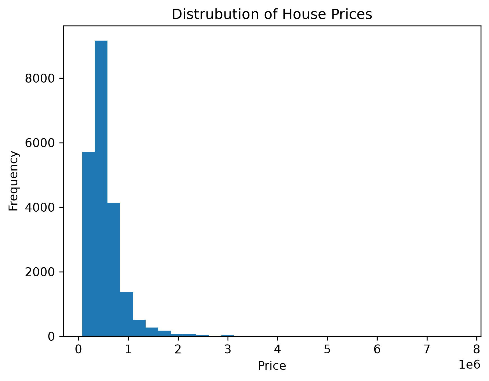
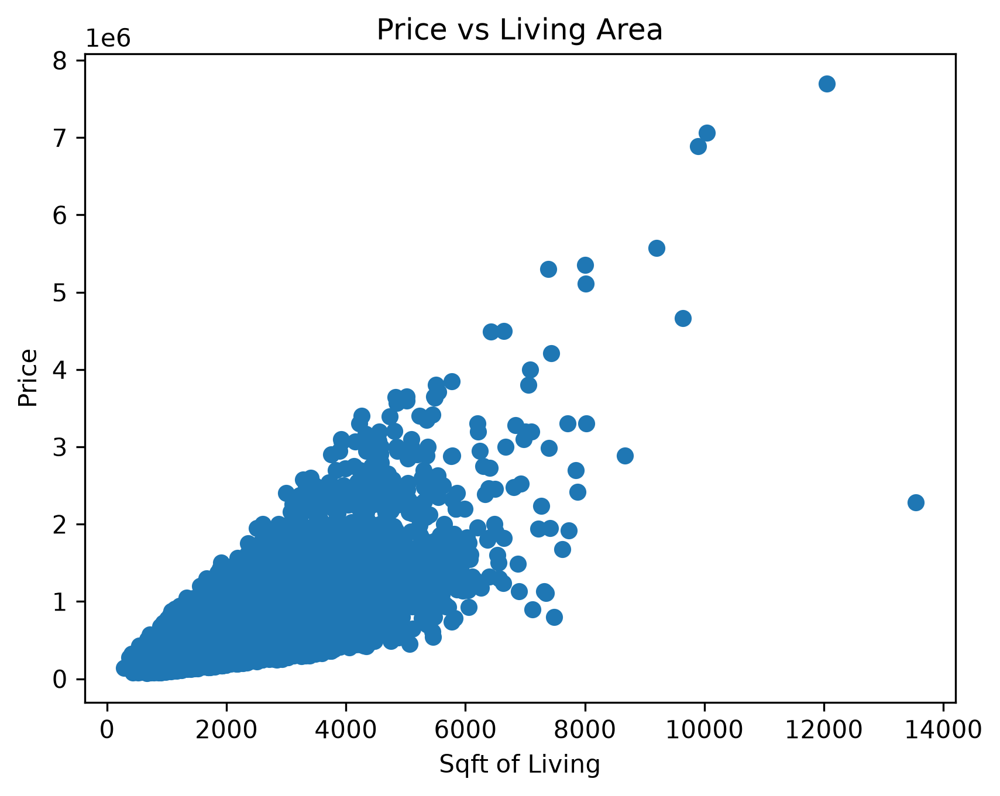
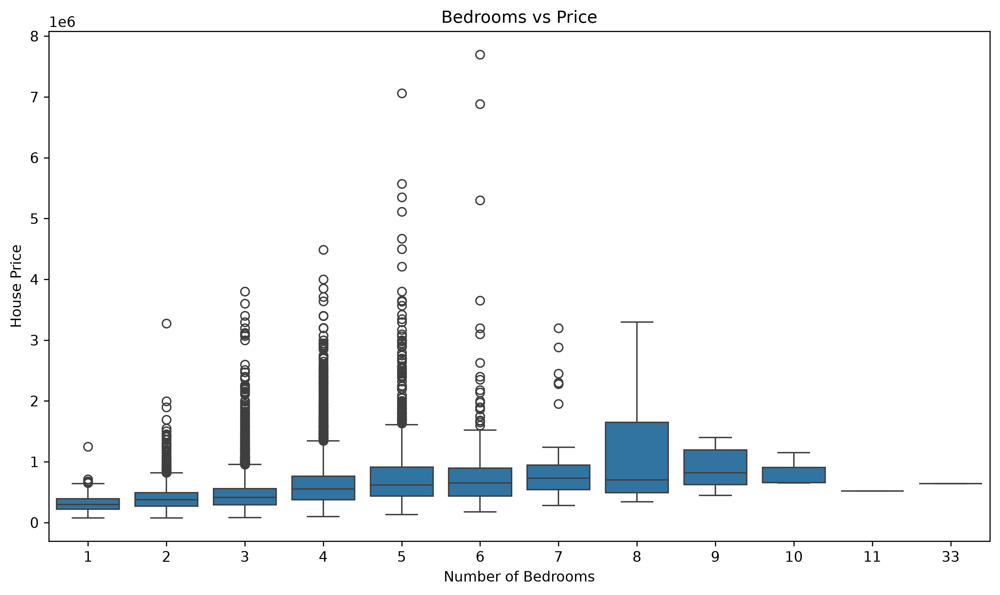
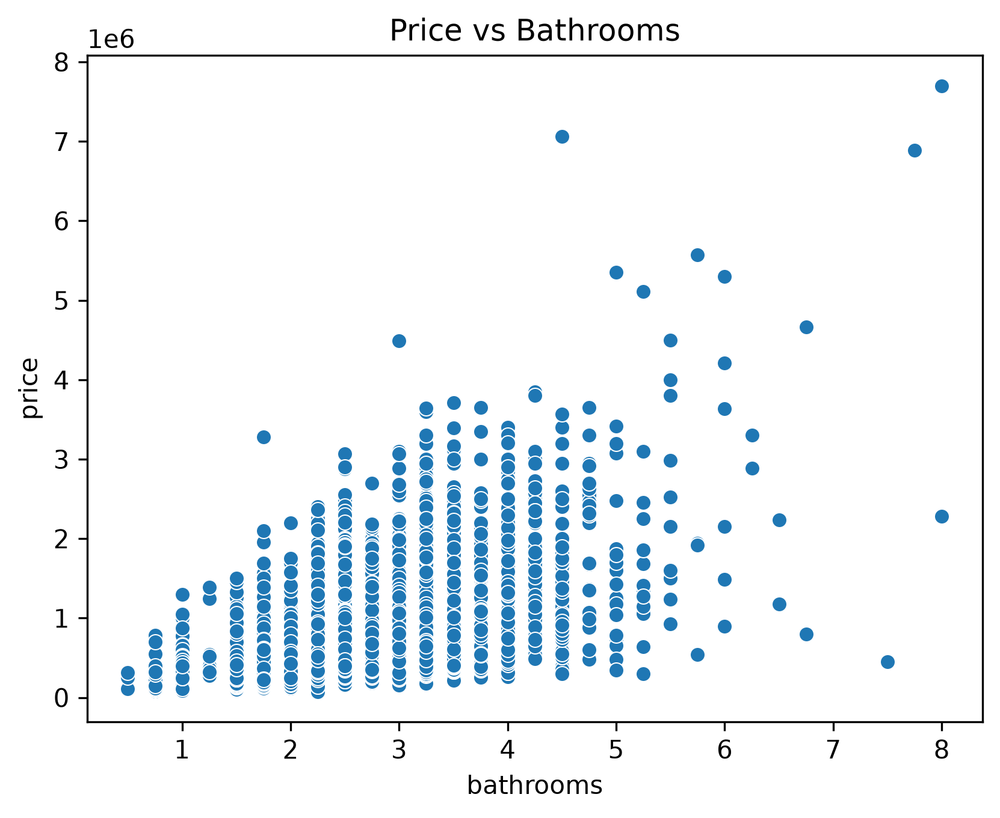
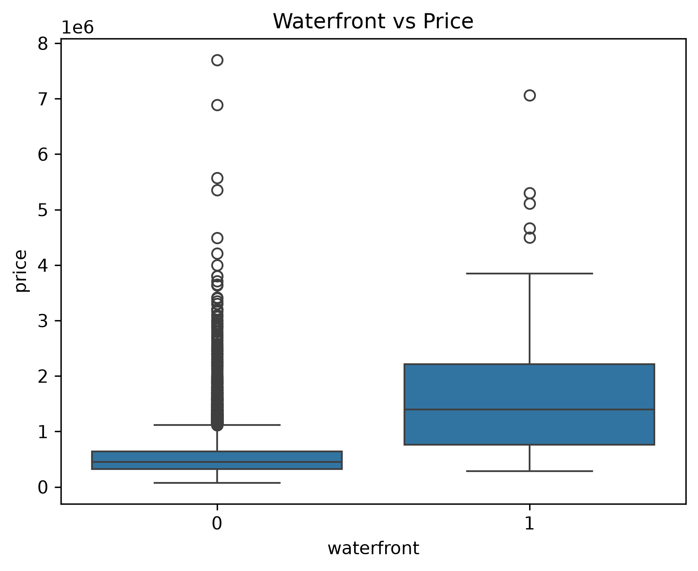
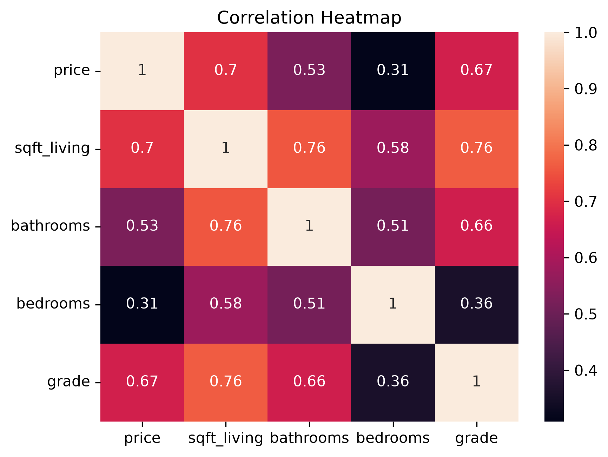

# 🏡 Smart Real-Estate Price Analytics

**Data Analytics Project using Python**

## 📌 Project Overview

This project analyzes the King County House Sales Dataset to explore real-estate prices, understand relationships between property features, and identify patterns in housing data.

The project focuses on Python-based data analysis and Exploratory Data Analysis (EDA) using Pandas, NumPy, Matplotlib, and Seaborn. The notebook investigates housing prices and property characteristics, while an exported HTML report makes the analysis easy to view in a browser.

## 🎯 Project Objectives

- Load, inspect, and prepare housing data using Python.
- Identify and handle missing values and data-quality issues.
- Perform data manipulation and preprocessing using Pandas and NumPy.
- Conduct Exploratory Data Analysis to identify patterns and relationships.
- Visualize housing prices and property characteristics using Matplotlib and Seaborn.
- Summarize findings that may support real-estate market analysis.

## 🛠️ Skills & Tools Used

- **Programming Language:** Python
- **Data Analysis:** Pandas, NumPy
- **Data Visualization:** Matplotlib, Seaborn
- **Data Analytics:** Data Cleaning, Data Preprocessing, Exploratory Data Analysis (EDA), Descriptive Statistics, Correlation Analysis, Data Visualization
- **Tools:** Jupyter Notebook, GitHub

## 📂 Dataset

**Dataset Name:** King County House Sales Dataset

The dataset contains historical house-sale records from King County, Washington, including sale prices, property attributes, and location-related information.

**Dataset source:** [King County House Sales Dataset on Kaggle](https://www.kaggle.com/datasets/harlfoxem/housesalesprediction)

The CSV included in this repository is the dataset version used for this project.

## 🔍 Project Workflow

### 1️⃣ Data Loading & Understanding

- Loaded the housing dataset into Python using Pandas.
- Examined the dataset structure, dimensions, columns, and data types.
- Used descriptive summaries to understand the available variables.

### 2️⃣ Data Quality & Preprocessing

- Checked the dataset for missing values.
- Investigated data-quality issues before analysis.
- Prepared relevant columns and data for exploratory analysis.

### 3️⃣ Exploratory Data Analysis (EDA)

Used Pandas, NumPy, Matplotlib, and Seaborn to explore the distribution of house prices and relationships between property characteristics.

**Analysis techniques include:**

- **Distribution analysis:** Examined the spread of sale prices.
- **Relationship analysis:** Explored how property features relate to sale price.
- **Visual analysis:** Used charts to make patterns and comparisons easier to interpret.
- **Statistical exploration:** Reviewed descriptive statistics and relationships among variables.

### 4️⃣ Interpretation & Findings

- Explored patterns in house prices and property attributes.
- Examined how selected property characteristics relate to sale price.
- Used visualizations to support interpretation of the dataset.
- Summarized observations from the notebook for further investigation.

*Specific findings should be interpreted from the charts and outputs in the notebook; exploratory relationships do not establish causation.*

## 📸 Project Screenshots

The following screenshots are taken from the visual outputs generated by the project notebook. They highlight the main exploratory analyses.

### 1. House Price Distribution


### 2. Living Area vs. House Price


### 3. Bedrooms vs. House Price


### 4. Bathrooms vs. House Price


### 5. Waterfront vs. House Price


### 6. Correlation Between Key Features

## 💡 Key Questions Explored

- How are house sale prices distributed?
- Which property characteristics appear related to sale price?
- How does living area relate to house price?
- What patterns can be observed across the available housing features?
- How can exploratory analysis help people better understand historical housing data?

## 📓 Python Analysis Notebook

The Jupyter Notebook contains the code, data preparation steps, exploratory analysis, and visualizations used in this project.

**[View Python EDA Notebook](./Real_Estate_Price_Analytics.ipynb)**

## 📊 HTML Analysis Report

An HTML export of the notebook is included so the analysis can be reviewed in a web browser without opening Jupyter Notebook.

**[View HTML Analysis Report](./Real_Estate_Price_Analytics.html)**

## 💼 Business Relevance

The analysis demonstrates how data analytics can help:

- **Property buyers:** Explore how property features relate to historical sale prices.
- **Real-estate professionals:** Compare attributes across housing records.
- **Market researchers:** Investigate patterns in historical housing data.
- **Aspiring data analysts:** Demonstrate practical skills in data cleaning, EDA, and visualization.

## 🚀 How to Run the Project

1. Clone or download this repository.
2. Make sure Python is installed.
3. Install the required libraries:

   ```bash
   pip install pandas numpy matplotlib seaborn jupyter
   ```

4. Start Jupyter Notebook from the project directory:

   ```bash
   jupyter notebook
   ```

5. Open `Real_Estate_Price_Analytics.ipynb` and run the notebook cells in order.

## 📁 Repository Structure

```text
Smart-Real-Estate-Price-Analytics/
│
├── Real_Estate_Price_Analytics.ipynb   # Python analysis notebook
├── Real_Estate_Price_Analytics.html    # Browser-viewable notebook report
├── kc_house_data_NaN.csv               # Housing dataset
├── Screenshots/                        # EDA chart screenshots embedded in README
│   ├── 01-house-price-distribution.png
│   ├── 02-living-area-vs-price.png
│   ├── 03-bedrooms-vs-price.png
│   ├── 04-bathrooms-vs-price.png
│   ├── 05-waterfront-vs-price.png
│   └── 06-feature-correlation-heatmap.png
└── README.md                           # Project documentation
```

## 🔮 Future Improvements

- Add deeper ZIP-code and location-based price comparisons.
- Explore historical price trends using date-based analysis.
- Build an interactive dashboard using Streamlit or Power BI.
- Develop a house-price prediction model and evaluate it with appropriate metrics.
- Add more detailed market insights and interactive dashboard screenshots.

## Conclusion

Smart Real-Estate Price Analytics demonstrates the use of Python for housing-data preparation, exploratory analysis, and visualization. The project provides a foundation for understanding historical house-sale patterns and can be extended with location analysis, interactive dashboards, and machine-learning-based price estimation.

The analysis is exploratory and is not a substitute for a professional property valuation. Historical patterns do not guarantee future prices.


